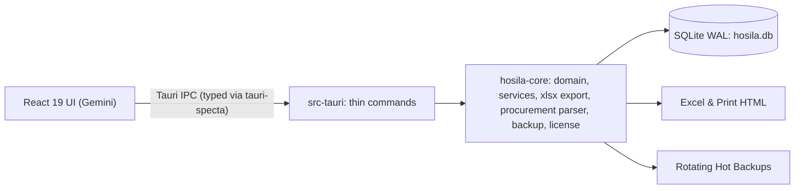

# Hosila IMS — Product & Build Plan (v3)

> **Status:** **v3 Finalized (ready for Phase B0 upon go-ahead). No code yet.**
> **Product:** **Hosila IMS** — standalone commercial Windows desktop application (single PC, offline, one-time licence per PC)
> **Forked from:** `apps/inventory` (React PWA) + `Hosila-backend/app/local_oms/inventory.py` (FastAPI + Postgres)
> **Build split:** **Backend (Rust · SQLite · Tauri 2) = Claude** · **Frontend (React 19 · TypeScript · Tailwind 4) = Gemini**
> **Launch customer:** De Palms Hotel (seeded separately starting **Mon 9 Nov 2026**; seed data does **not** ship with the product installer)

---

## 0. Locked Decisions

| # | Decision |
| --- | --- |
| **D1** | **Single PC.** Pure local SQLite (WAL). No LAN host/client mode, no network file shares, and no external HTTP server. |
| **D2** | **Collection sign-off & dating.** Every collection records **Collector** (staff dropdown filtered by department), **Storekeeper** (staff dropdown from the Store team), **Entered by** (logged-in user), and an editable **Collection Date** (defaults to today; allows entering back-dated Week 2 issues for **9–15 Nov 2026**). |
| **D3** | **Hard stock block.** Issuing more than available stock is blocked with an inline message: *"Quantity is more than available. Only X [unit] in stock."* Enforced in both the UI and the Rust transaction (`INSUFFICIENT_STOCK`). |
| **D4** | **Returnable items in v1.** Supported via an `is_returnable` flag per item plus Check-Out / Check-In / Returns tracking. None of De Palms' seeded items are marked returnable, but the capability ships cleanly for other hotels. |
| **D5** | **Commercial licensing.** One-time offline licence per PC (Ed25519 signed licence file bound to a machine fingerprint). |
| **D6** | **Protein as a Store Section.** `Protein` is modeled as a **store section** that **Kitchen** staff collect from (`store_sections`, optional per item, separate from `departments` which govern who collects). Kitchen staff see Kitchen + Protein items during Collection, while Procurement and Weekly Stock Sheet exports still group `KITCHEN`, `PROTEIN`, `F&B`, and `HOUSEKEEPING` into separate sections with subtotals and summary lines matching the De Palms Excel layout. |
| **D7** | **Built-in Rust Procurement List Parser (no external API).** Replaces any external HTTP/AI API with an in-process Rust parser (`calamine` + fuzzy matching + `item_aliases` memory) that reads uploaded filled procurement `.xlsx` files and presents a **Storekeeper Confirmation** screen before updating stock. |
| **D8** | **De Palms Seed Rules:** Start from **Mon 9 Nov 2026** using the **WEEK 2** sheet only (do not import Week 1). Week 2 `ISSUED` stays `0` on seed so staff can enter Week 2 issues directly in Hosila IMS. For **PINEAPPLE**, drop Kitchen's duplicate row (row 80, 2 BALLS purchased) and keep F&B's row (row 265, `PCS`, 0 stock, ₦1,500) as a single item linked to **both** `F&B` and `Kitchen` departments. Final seed totals: **370 items**, closing value **₦7,196,758.12** (72 items flagged `cost_missing` at ₦0; 5 beer brands split by Can vs Bottle; unit spellings normalized; Hisense 50" TV defaulted to `PCS`). |
| **D9** | **Brand, Theme & Typography:** Name **Hosila IMS**, icon from `Hosila icon lime.svg` (`#21C29C`), wordmark from `Hosila Branding colorised.png`. **Dark mode:** true/near-black canvas, soft white text, touch of Hosila green (`#21C29C`) accent. **Light mode:** mostly white surfaces, soft dark text (`#1D1D1F`), touch of Hosila green accent. **Typography:** clean, modern Apple-style sans-serif using bundled **Inter Variable** (SIL OFL) with Apple HIG desktop sizing, tracking, and `tabular-nums`. Governed by **both** `.claude/skills/emilkowalski-skills` and `.claude/skills/apple-design-dickwu`. |

---

## 1. Architecture (Pure Local Tauri 2 + Rust + SQLite)



**Core principle:** Every business rule (UoM conversions, `INSUFFICIENT_STOCK` blocking, WAC costing, document numbering, audit logging, Excel parsing) lives in one dependency-free Rust library (`hosila-core`). `src-tauri` stays a thin desktop shell.

### 1.1 Cargo Workspace & Repository Layout

```text
hosila-ims/
├─ PLAN.md
├─ crates/
│  └─ hosila-core/            # No Tauri dependency → fast unit & integration tests
│     ├─ db/                  # SQLite WAL pool (1 writer mutex + readers), refinery migrations, backup, integrity check
│     ├─ domain/              # uom.rs, money.rs, costing.rs, numbering.rs (pure, deterministic)
│     ├─ services/            # auth, settings, departments, store_sections, staff, units, items,
│     │                       # collections, returns, procurement, receipts, adjustments, stock_take, reports, dashboard, activity
│     ├─ export/              # rust_xlsxwriter exporters (Procurement + Weekly Stock Sheet) + print HTML templates
│     ├─ parser/              # calamine + strsim procurement list parser, anomaly detector, weekly-sheet importer
│     ├─ license/             # Ed25519 offline machine-bound activation & trial state
│     └─ error.rs             # AppError { code, message, field?, meta? }
├─ src-tauri/                 # Tauri 2 shell: commands/, app state, installed/portable paths, tray, updater
├─ src/                       # React 19 + TypeScript + Tailwind 4 frontend (Gemini)
├─ bindings/                  # Auto-generated TypeScript bindings & DTOs (tauri-specta)
├─ migrations/                # Embedded SQL migrations (refinery)
├─ seed-packs/                # Customer seed packs (gitignored, NEVER bundled in installer)
└─ docs/CONTRACT.md           # Versioned backend ↔ frontend contract & JSON fixtures
```

### 1.2 Backend Technical Choices & Data Integrity

| Concern | Choice |
| --- | --- |
| **Database** | `rusqlite` (bundled SQLite with FTS5). **WAL mode**, `foreign_keys = ON`, `busy_timeout = 5000`. One writer connection behind a `Mutex` + connection pool for concurrent reads. (SQLite beats MS Access cleanly: zero external runtime, no 2 GB ceiling, hot online backup, ACID under power loss, free commercial redistribution.) |
| **Migrations** | `refinery` (embedded versioned SQL migrations run automatically on startup). |
| **Search** | **SQLite FTS5** virtual table indexed on item name, SKU, and `item_aliases` for instant sub-10ms search. |
| **Numeric Precision** | **No floats in storage or domain maths.** Quantities = `INTEGER` milli-units (`×1,000`); Money = `INTEGER` kobo/minor units (`×100`); Unit cost = `INTEGER` micro-naira (`×1,000,000`) so small per-gram/per-ml costs never round to zero. Explicit rounding only at boundaries (purchase suggestions round **up**; currency values round half-even). |
| **IDs & Numbering** | `TEXT` UUIDv7 (time-sortable) primary keys + sequential human document numbers per type (`COL`, `RET`, `PRL`, `GRN`, `ADJ`, `CNT`). |
| **Timestamps & Dates** | Timestamps stored in UTC ISO-8601, displayed in local time. Business/collection/receipt date stored explicitly so back-dated Week 2 entries work cleanly. |
| **Authentication** | `argon2id` password hashes + optional 4–6 digit quick PIN for storekeeper/manager overrides. |
| **Excel I/O** | `rust_xlsxwriter` for styled exports with live Excel formulas (`=D*E`, `=SUM(...)`), merged headers, and print setup; `calamine` for `.xlsx`/`.xls` parsing and import. |
| **Type Bridge** | **`tauri-specta`** generates `bindings/bindings.ts` directly from Rust structs and commands — Gemini never hand-writes IPC DTOs. |
| **Errors** | Structured `AppError { code, message, field?, meta? }` (e.g. `INSUFFICIENT_STOCK`, `UNIT_CONVERSION_NEEDED`, `LICENSE_INVALID`). |
| **Deployment Modes** | **Installed** (NSIS `Setup.exe`, data in `%APPDATA%\Hosila IMS\`) + **Portable** (`.zip` with `portable.flag` next to `HosilaIMS.exe`, data in `.\data\`). Startup warns if the DB sits on a UNC/network path. |

---

## 2. Built-In Rust Procurement List Parser

Replaces the external API idea with a zero-setup, offline, two-tier Excel parser inside `hosila-core::parser` backed by a mandatory **Storekeeper Confirmation Gate**.

### 2.1 Two-Tier Parsing Strategy

1. **Tier 1 — Deterministic Round-Trip (Hosila-exported `.xlsx`):**
   When Hosila IMS exports a Procurement List to Excel, it writes a hidden `_hosila_meta` worksheet storing `procurement_list_id`, `line_id`, `item_id`, `unit_id`, `factor_milli`, and sheet/row anchors. When the buyer fills in quantities/prices in Excel and the storekeeper uploads the file back, Hosila matches every row 100% deterministically — even if quantities, unit prices, or amounts were edited.
2. **Tier 2 — Smart Heuristic Parser (external / De Palms-style `.xlsx`):**
   Handles external multi-sheet buyer workbooks (e.g. `Sheet1` master + `NINA'S LIST` + `MARGARET'S LIST` from the sample):
   - Detects title banner and buyer name from sheet headers (e.g. `NINA'S LIST`, `MARGARET'S LIST`).
   - Detects section headers (`KITCHEN`, `PROTEIN`, `F & B`, `HOUSEKEEPING`) and skips `TOTAL` rows.
   - Extracts the `SUMMARY` block, capturing non-stock **extra charges** (`TRANSPORT/POS/GRINDING/WHEEL B.`, `BANK CHARGES`) and cash reconciliation rows (`DISBURMENT`/`DISBURSEMENT`, `ACTUAL EXP.`, `REFUNDED TO CASH CONTROLLER`).
   - Lets the storekeeper choose which sheet(s) to parse when both a master sheet and individual buyer sheets exist, preventing double-counting.

### 2.2 Item Matching Pipeline

1. **Exact normalized match** (trimmed, case-folded, collapsed spaces) against `items.name` / `items.sku`.
2. **Saved alias lookup** in `item_aliases` (e.g. mapping `"BASMATIC RICE"` → `"BASMATI RICE"`, `"AIRFRESHNER"` → `"AIR FRESHENER"`, `"LIQUID SOUP/BLEACH"` → target item).
3. **Fuzzy similarity** via `strsim` (Jaro-Winkler + token overlap), weighted by matching department/store section, returning ranked `suggested` candidates or `unmatched`.

### 2.3 Real-World Anomaly Checks (Derived from the De Palms Week 3 Sample)

| Flag Code | Real Sample Example | How the Confirmation UI Resolves It |
| --- | --- | --- |
| `AMOUNT_MISMATCH` | `VEGETABLE OIL`: `25 LITRES`, `UNIT PRICE = 68,000`, `AMOUNT = 68,000` (keg total typed in unit price); `KETCHUP`: `1 × 2,500 ≠ 5,000` | Highlights row in amber; shows sheet qty/price/amount alongside computed `amount / qty` (`₦2,720/L`) so the storekeeper picks the true unit cost. |
| `AMOUNT_ONLY` | `ONION`: blank qty, `₦10,000` lump sum; `FRESH PEPPER ₦16,000` | Marks row **"Qty required"**. Storekeeper enters the physical quantity received in stock units (e.g. `8 KG`), and the app derives `unit_cost = amount / qty`. |
| `UNIT_CONVERSION_NEEDED` | `BASMATIC RICE` bought by `PACK`, stocked in `KG`; `WATER` bought by `PACK`, stocked in `BOTTLES` | Uses saved `item_units` conversion automatically if configured; otherwise prompts the storekeeper for the factor (`1 PACK = ? KG`) with a *"Remember for future uploads"* checkbox. |
| `UNMATCHED_ITEM` | New market item or spelling variant | Storekeeper links to an existing item (with *"Save alias"*), creates a new item inline, or marks the row skipped. |
| `PRICE_JUMP` | Derived unit cost differs `> 50%` from item's last cost | Shows a non-blocking warning badge comparing previous vs new unit cost. |

### 2.4 Mandatory Storekeeper Confirmation Gate

The parser **never** modifies inventory balances directly. It outputs a `ParsedProcurementDraft` preview containing matched lines, flagged items, buyer/extra charges, and cash reconciliation. The storekeeper resolves any flagged rows, confirms **Received by** (staff), **Storekeeper approving** (Store staff), **Received date**, and optional link to an open Procurement List, then clicks **Confirm & Post Restock** — executing one atomic SQLite transaction (GRN + stock movements + WAC recalculation + saved aliases/conversions + activity log).

---

## 3. Core Domain Rules: UoM, Costing & Data Model

### 3.1 Units of Measure (UoM) & Costing Rules

1. **One Base (Stocking) Unit per item:** The smallest unit handled or issued (e.g. `BOTTLE`, `PCS`, `KG` or `G`, `LITRE` or `ML`). Stock never sits at `0.33 crate`.
2. **Two Conversion Layers:**
   - **Global physical conversions** (Settings → Units): count/mass/volume dimensions (`KG ↔ G = 1000`, `L ↔ ML = 1000`, `DOZEN ↔ PCS = 12`).
   - **Item-specific conversions** (`item_units`): packaging and local market units (`CRATE`, `CARTON`, `PACK`, `BAG`, `PAINT`, `CUP`, `PORTION`, `HEAD`, `BALL`, `BASKET`, `WHOLE`, `ROLL`) are always per item with `can_purchase` / `can_issue` flags.
3. **Validation & Sanity Guardrails:** Positive factors only, live conversion preview (*"1 Crate = 24 Bottles · 3 Crates = 72 Bottles"*), and confirmation prompt on unusually large count multipliers (`> 1000`).
4. **Immutable Transaction Snapshots:** Every collection, receipt, and movement stores `input_unit_id`, `input_qty_milli`, `factor_milli`, and resulting `base_qty_milli`. Changing a pack size later never corrupts historical balances.
5. **Base Unit Lock:** Once an item has movements, its base unit locks. Changing it requires an Admin-only guarded **"Change Base Unit"** wizard that rescales on-hand, thresholds, and cost atomically.
6. **Display Upscaling:** Balances display in human-friendly form (e.g. `76 btl → 3 crates + 4 btl`, `12,500 g → 12.5 kg`).
7. **Weighted Average Cost (WAC):** Updated on every receipt (`(on_hand × avg + received × unit_cost) / (on_hand + received)`). Issues snapshot the active WAC onto the movement row so daily consumption value and historical reports remain exact.
8. **Immutable Ledger:** `stock_movements` is append-only. Mistakes are corrected via **Reversal** documents with an audit reason, never silent edits. Startup runs a fast ledger reconciliation check (`SUM(movements) == on_hand`).

### 3.2 SQLite Schema Draft

```text
settings(key PK, value_json)
users(id, username UNIQUE, full_name, password_hash, pin_hash NULL, role[admin|storekeeper|viewer], is_active, created_at)
departments(id, name UNIQUE, color, sort_order, is_active)           -- e.g. Kitchen, F&B, Housekeeping, Maintenance, Store
store_sections(id, name UNIQUE, sort_order, is_active)               -- e.g. Protein (grouped for exports, collected by Kitchen)
staff(id, full_name, staff_code NULL, phone NULL, is_store_staff, is_active, created_at)
staff_departments(staff_id, department_id)                           -- many-to-many

units(id, code UNIQUE, name, plural, dimension[count|mass|volume|length],
      allows_decimals, factor_to_dim_base_milli, is_system)

items(id, sku UNIQUE, name, description NULL, base_unit_id, display_unit_id,
      default_issue_unit_id, default_purchase_unit_id,
      store_section_id NULL, on_hand_milli, avg_cost_micro, last_cost_micro,
      cost_missing, is_returnable, reorder_point_milli, par_level_milli,
      supplier_id NULL, storage_location NULL, is_active, created_at, updated_at)
item_departments(item_id, department_id)                             -- many-to-many (e.g. Pineapple -> F&B + Kitchen)
item_units(id, item_id, unit_id, factor_milli, can_purchase, can_issue, label_override NULL)
item_aliases(id, item_id, alias_normalized UNIQUE, created_at)       -- trained by Procurement Parser confirmations
suppliers(id, name, phone NULL, email NULL, notes NULL, is_active)

collections(id, number UNIQUE, department_id, collector_staff_id, collector_name_snapshot,
            storekeeper_staff_id, storekeeper_name_snapshot, created_by_user_id,
            collection_date, notes NULL, status[posted|reversed], posted_at)
collection_lines(id, collection_id, item_id, unit_id, input_qty_milli, factor_milli,
                 base_qty_milli, unit_cost_micro, line_value_minor,
                 is_returnable, returned_qty_milli, damaged_qty_milli,
                 return_status[na|out|partial|returned], returned_at NULL)

procurement_lists(id, number UNIQUE, title, scope[low_stock|full|custom], department_ids_json,
                  status[draft|finalised|partial|received|closed], prepared_by_user_id,
                  extra_charges_json, created_at)
procurement_lines(id, list_id, item_id, section_label, buyer_name NULL, unit_id NULL,
                  factor_milli, suggested_qty_milli, ordered_qty_milli NULL,
                  est_unit_cost_minor NULL, budget_amount_minor NULL, received_qty_milli)

receipts(id, number UNIQUE, procurement_list_id NULL, supplier_id NULL, invoice_ref NULL,
         source_type[manual|parsed_excel|seed], source_filename NULL,
         received_by_staff_id, received_by_name_snapshot,
         approved_by_staff_id, approved_by_name_snapshot, posted_by_user_id,
         received_at, disbursement_minor NULL, actual_expense_minor NULL, refunded_minor NULL,
         extra_charges_json, total_minor, notes NULL, status[posted|reversed], created_at)
receipt_lines(id, receipt_id, procurement_line_id NULL, item_id, unit_id, input_qty_milli,
              factor_milli, base_qty_milli, unit_cost_minor, line_total_minor)

adjustments(id, number UNIQUE, reason[wastage|spoilage|damage|expired|found|count_correction],
            notes, posted_by_user_id, approved_by_user_id NULL, adjustment_date, posted_at)
adjustment_lines(id, adjustment_id, item_id, unit_id, input_qty_milli, factor_milli, base_qty_milli, unit_cost_micro)

stock_counts(id, number UNIQUE, scope_json, status[draft|posted], started_at, posted_by_user_id NULL, posted_at NULL)
stock_count_lines(id, stock_count_id, item_id, system_qty_milli, counted_qty_milli NULL, variance_milli NULL)

stock_movements(id, item_id, type[opening|issue|receipt|adjustment|count|reversal|tool_out|tool_in],
                qty_milli, balance_after_milli, unit_cost_micro, value_minor,
                department_id NULL, doc_type, doc_id, doc_number,
                input_unit_id, input_qty_milli, factor_milli,
                actor_user_id, counterparty_staff_id NULL, storekeeper_staff_id NULL,
                business_date, created_at)
activity_log(id, at, user_id, action, entity, entity_id, summary, meta_json)
import_runs(id, profile, filename, items_created, items_updated, warnings_json, imported_by_user_id, created_at)
doc_sequences(doc_type PK, prefix, next_value)
license(id PK, payload_json, signature_b64, activated_at)
```

---

## 4. Module & Screen Specifications

| Screen / Module | Key Capabilities |
| --- | --- |
| **Dashboard** | Animated KPIs (`NumberFlow`, `tabular-nums`): Total inventory value, Low stock count, Out-of-stock count, Value consumed today, Value received today, Collections today, Open returnable checkouts, Cost-missing alert count. Charts (`recharts`): 7/30-day consumption by department + top consumed items. **Activity Log:** filterable timeline (*who collected what, when, approved by which storekeeper, restocks received/signed by*), relative timestamps for 7 days then absolute dates, click any row to inspect voucher/GRN. |
| **Inventory** | Grouped by department (with Store Section badge e.g. `Protein`) + flat-list toggle; items shared across departments show under each with *"Also in: ..."*; instant FTS5 search; filters (department, section, healthy/low/out, cost missing, returnable). **Add item** (not restock) & **Edit item** (name, multi-department chips, store section, base unit + item-specific conversions with live preview, thresholds, returnable flag, archive). Detail drawer with stock card & movement sparkline. |
| **Collection** | Keyboard-first counter flow (zero animation on frequent inputs). Pick **Department** → shows only items linked to that department (Kitchen includes Protein section items) → pick multiple items + qty + unit (live conversion + remaining stock preview) → **Collector** dropdown (filtered by dept) → **Storekeeper** dropdown (Store team) → **Collection Date** (editable, defaults to today) → **Post**. Hard blocks over-issue (`INSUFFICIENT_STOCK`). Returnable items auto-open a check-out record. |
| **Returns** | Dedicated view for items flagged `is_returnable` currently checked out: outstanding items by staff/department, full/partial return, damaged-return logging (posts adjustment automatically). |
| **Procurement & Restock** | **1. Build List:** tick departments → choose scope (*Low stock only*, *Full department*, *Custom filterable picker*) → suggested order qty rounded up to purchase units, buyer assignment (e.g. Nina / Margaret), extra charges, amount-only lines.<br>**2. Export & Print:** reproduces the **De Palms Procurement List** Excel layout (blue title banner, `S/N · DESCRIPTION · VOLUME · QUANTITY · UNIT PRICE · AMOUNT`, grey section headers + `=SUM()` totals, `SUMMARY` with extra charges & `GRAND TOTAL`, cash reconciliation rows, one sheet per buyer + master, plus hidden `_hosila_meta`), and print-ready HTML.<br>**3. Receive / Restock:** either *"Receive against list"* manually **or** **"Upload Filled Procurement Excel"** to invoke the Rust Parser → Storekeeper Review & Confirmation screen → Post GRN + WAC + cash reconciliation. |
| **Stock Take & Adjustments** | Printable/Excel count sheet → enter physical counts → variance review → post `count_correction` movements; standalone Wastage / Spoilage / Damage / Found adjustments with required reason and optional manager PIN. |
| **Reports** | **Weekly / Monthly Stock Sheet** exported in the familiar De Palms column layout (`S/N · DEPARTMENT · DESCRIPTION · QUANTITY · OPENING · PURCHASE · TOTAL · ISSUED · CLOSING · UNIT COST · AMOUNT`), accurately valuing `AMOUNT = CLOSING × UNIT COST`; Department Consumption report; Item Stock Card; Procurement vs Received variance. |
| **Settings** | Business profile & logo, Departments, Store Sections, Staff (assigned to departments + Store flag, bulk Excel import), User accounts (Admin / Storekeeper / Viewer + quick PIN), Units & global conversions, Inventory rules (negative stock locked off by default, PIN thresholds, WAC), Backups & Restore, Offline Licence, Appearance (Light / Dark / System). |

---

## 5. Design System Specification (For Gemini — Dual `.claude` Skills)

Every UI decision must follow **both** skill sets in `c:\Users\User\OneDrive\Desktop\Hosila\.claude\skills\`:
1. **`emilkowalski-skills`**: `emil-design-eng`, `pick-ui-library`, `apple-design`, `ui-cheatsheet`, `review-animations`
2. **`apple-design-dickwu`**: `SKILL.md`, `references/cross-platform.md`, `references/hig/dark-mode.md`, `references/hig/typography.md`, `references/hig/color.md`, `references/hig/accessibility.md`, `references/hig/designing-for-macos.md`

### 5.1 Color System (Light & Dark Mode Tokens)

Hosila green (`#21C29C` from `Hosila icon lime.svg`) is reserved strictly as an intentional **accent**, never overwhelming surfaces. Both themes maintain WCAG AA contrast (`≥ 4.5:1` for body text, `≥ 3:1` for large/bold text and UI controls) and never convey status by color alone.

| Role | Light Mode | Dark Mode | Notes |
| --- | --- | --- | --- |
| **Primary Canvas** | `#FFFFFF` | `#000000` (main `#09090B`) | Clean white in light mode; true/near-black in dark mode |
| **Sidebar / Grouped Bg** | `#F5F5F7` | `#111113` | Apple base vs elevated hierarchy (brighter layers step forward in dark mode) |
| **Elevated Card / Popover / Modal** | `#FFFFFF` | `#18181B` (modal `#1C1C1F`) | Subtle elevation shadow in light mode; lighter elevated surface in dark mode |
| **Hairline Border** | `#E5E5EA` | `rgba(255, 255, 255, 0.10)` | `1px` crisp structural dividers |
| **Text Primary** | `#1D1D1F` | `#F5F5F7` | Soft dark on light; soft off-white on black to prevent halation |
| **Text Secondary / Tertiary** | `#6E6E73` / `#8E8E93` | `#A1A1A6` / `#6E6E73` | Clear typographic hierarchy |
| **Accent Fill (Primary CTA, Active Mark)** | `#21C29C` (text `#062B22`) | `#21C29C` (text `#05231C`) | High-contrast dark ink on `#21C29C` fills (`> 8:1` contrast) |
| **Accent Text / Links / Focus** | `#0D7A5F` | `#34D3AA` | `#21C29C` alone on white is ~2.3:1 (fails AA); darkened `#0D7A5F` passes `> 5.1:1` |
| **Accent Subtle Tint (Active Nav Pill)** | `rgba(33, 194, 156, 0.10)` | `rgba(33, 194, 156, 0.14)` | Calm focus/selection wash |
| **Status: Healthy / Low / Out** | `#16A34A` / `#D97706` / `#DC2626` | `#30D158` / `#FFD60A` / `#FF453A` | Always paired with icon/badge text |

### 5.2 Apple-Style Typography

Apple's `SF Pro` licence restricts redistribution inside third-party Windows `.exe` bundles, so we bundle **Inter Variable** (SIL Open Font License, offline `.woff2`) tuned to match Apple's desktop HIG optical sizing, leading, and tracking:
- **Font stack:** `'Inter Variable', -apple-system, BlinkMacSystemFont, 'Segoe UI Variable', system-ui, sans-serif`
- **CSS features:** `font-optical-sizing: auto; font-feature-settings: "cv05" 1, "cv11" 1, "ss01" 1;`
- **Desktop scale (per Apple HIG `typography.md`):**
  - Page Title: `22px / 28px`, weight `600`, tracking `-0.02em`
  - Section Heading: `15px / 20px`, weight `600`, tracking `-0.015em`
  - Body / Table Cells: `13.5px / 20px`, weight `400`, tracking `0em` (avoid Light/Thin weights on small text)
  - Control Labels / Table Headers: `11.5px / 16px`, weight `500`, tracking `+0.01em` (minimum `11px`)
- **Numbers:** `font-variant-numeric: tabular-nums` on every KPI, stock balance, quantity, cost, and currency cell so columns align cleanly and counters never jitter.

### 5.3 UI Library Stack & Motion Standards

- **Curated libraries (from `pick-ui-library`):**
  - **Base UI** (`@base-ui-components/react`) for accessible dialogs, popovers, selects, menus, comboboxes
  - **`cmdk`** for `Ctrl+K` quick jump / action palette
  - **Sonner** for stacked toast notifications
  - **NumberFlow** for dashboard KPI counters
  - **recharts** for dashboard charts
  - **Virtuoso** (`react-virtuoso`) for smooth 1,000+ row tables
  - **zustand** + **TanStack Query** for state & IPC caching
  - **Tailwind CSS 4** + **`clsx`** + **`cva`**; **`lucide-react`** icons weight-matched to `1.75` stroke
- **Motion & Craft Rules:**
  - **Zero animation** on keyboard-initiated and 100+/day actions (`Ctrl+K`, search typing, adding collection lines, tab switching).
  - **Press feedback:** `transform: scale(0.97)` on `:active` (`100–160ms ease-out`).
  - **Popovers/selects:** origin-aware (`transform-origin: var(--transform-origin)`), `150–200ms cubic-bezier(0.23, 1, 0.32, 1)`, never `ease-in`, never `scale(0)`, never `transition: all`.
  - **Modals:** centered (`scale(0.96)` + `opacity: 0` entry, faster exit than enter). **Drawers:** critically damped spring (`damping: 1.0`, `response: 0.35`, interruptible) or iOS drawer curve `cubic-bezier(0.32, 0.72, 0, 1)`.
  - **Accessibility & Platform Polish:** Gate hover effects behind `@media (hover: hover) and (pointer: fine)`; honor `prefers-reduced-motion`, `prefers-reduced-transparency`, and `prefers-contrast`; support full keyboard navigation, desktop window resize fluidity, and `Intl.PluralRules` / absolute dates after 7 days; specific labels (*"Post Collection"*, *"Save Changes"*, never *"Submit"*).

---

## 6. Phased Build Plan (Fast-Track for De Palms Week 2 Entry)

### Pre-B0 Environment Prerequisites

- Checked on this machine: **Node `v24.22.1`** and **`pnpm 11.25.0`** are installed; `winget v1.29.380` is available.
- **Missing on this PC:** **Rust toolchain (`rustup` / `rustc` / `cargo`)** and **Visual Studio C++ Build Tools (`MSVC`)** required by Tauri 2 + native Rust compilation. Installing both via `winget` is Step 0 right after plan sign-off.

### Milestone 1 — Fast-Track Operational MVP (Unlocks De Palms Week 2 Issues Entry)

| Phase | Backend Deliverables (Claude) | Parallel Frontend Track (Gemini) |
| --- | --- | --- |
| **B0 Foundation** | Cargo workspace (`hosila-core`, `src-tauri`), Tauri 2 shell, installed/portable path detection, SQLite WAL + `refinery` migrations, `AppError`, `tauri-specta` TypeScript generation, default units seed, `--dev-seed`, `docs/CONTRACT.md` v0 | **F0:** Design system tokens (light white/soft-dark/green + dark black/soft-white/green), Inter Variable font setup, Base UI primitives, Sonner, `cmdk`, App shell & sidebar with Hosila branding |
| **B1 Identity & Settings** | Users (`argon2id`, Admin/Storekeeper/Viewer roles, PIN), login/session, business profile & logo, `departments`, `store_sections` (incl. `Protein`), `staff ↔ departments` + Store team flag, global `units` & conversions, rules | **F1:** Login screen, Settings screens (Business, Departments, Store Sections, Staff, Users, Units, Rules, Theme toggle) |
| **B2 Items & UoM Engine** | Items CRUD, multi-department links, `store_section_id`, `item_units` conversions (`can_purchase` / `can_issue`), `is_returnable`, `cost_missing`, FTS5 search, stock card, display upscaling helper, opening balance posting | **F2:** Inventory list (grouped by dept + flat view, search/filters), Add/Edit Item modal with UoM builder & live conversion preview, Item detail drawer |
| **B3 Collections & Returns** | Atomic collection posting (editable `collection_date`, collector + storekeeper snapshots, `INSUFFICIENT_STOCK` hard block), live `validate_collection`, returnable check-out / check-in / partial & damaged return | **F3:** Keyboard-first Collection screen (dept → items → collector & storekeeper → date → post) + Returns screen |
| **B4a De Palms Seed Pack** | Generic weekly-sheet Excel importer + De Palms Week 2 (`9–15 Nov`) seed run: 370 items, Protein section under Kitchen, Pineapple deduplicated to F&B + shared with Kitchen, 72 `cost_missing` flags, reconciliation report matching **₦7,196,758.12** | Import preview / reconciliation summary UI |

> 🎯 **Checkpoint 1:** Once **Milestone 1** lands, De Palms has its 9 Nov opening balances loaded and can enter all **9–15 Nov (Week 2)** collections and updates directly in Hosila IMS.

### Milestone 2 — Procurement, Built-In Rust Parser & Restock

| Phase | Backend Deliverables (Claude) | Parallel Frontend Track (Gemini) |
| --- | --- | --- |
| **B4b Procurement & Export** | List builder (depts × low-stock/full/custom), par-based order suggestion rounded up to purchase units, buyer split, extra charges, amount-only lines, **De Palms `.xlsx` export** (with hidden `_hosila_meta`) + print HTML, manual GRN receiving + WAC + cash reconciliation | **F4a:** Procurement builder, buyer split, live preview, Excel export & Print view, Manual Receive against list |
| **B5 Built-In Rust Parser** | `hosila-core::parser`: Tier 1 `_hosila_meta` round-trip + Tier 2 multi-sheet buyer workbook parser, `item_aliases` + `strsim` matching, anomaly detector (`AMOUNT_MISMATCH`, `AMOUNT_ONLY`, `UNIT_CONVERSION_NEEDED`, `UNMATCHED_ITEM`, `PRICE_JUMP`), atomic Storekeeper Confirm & Post Restock | **F4b:** Upload Filled Procurement `.xlsx` screen with inline anomaly resolution, conversion/alias prompts, and Storekeeper Confirm & Post |

### Milestone 3 — Dashboard, Reports, Control & Commercial Release

| Phase | Backend Deliverables (Claude) | Parallel Frontend Track (Gemini) |
| --- | --- | --- |
| **B6 Dashboard, Reports & Control** | Indexed KPI queries (<50ms), filterable Activity Log, Weekly/Monthly Stock Sheet `.xlsx` export (De Palms layout, valuing `CLOSING × UNIT COST`), department consumption & item stock card reports, stock take (count sheets, variance, post), adjustments & reversal documents | **F5:** Dashboard (NumberFlow KPIs, recharts, live Activity Log), Reports screen, Stock Take & Adjustments UI |
| **B7 Commercial Hardening** | Automated rotating hot backups + restore wizard, startup integrity & ledger reconciliation check, offline Ed25519 licence bound to PC fingerprint + trial mode, NSIS `Setup.exe` + portable `.zip`, code signing prep, first-run onboarding wizard | **F6:** First-run onboarding wizard, Backup/Restore & Offline Licence UI, full accessibility/motion audit against `emilkowalski-skills` and `apple-design-dickwu` |

---

## 7. Backend ↔ Frontend Handoff Protocol

1. **Contract first:** Each backend phase starts by updating `docs/CONTRACT.md` (commands, DTOs, error codes, UI validation rules) and providing sample JSON fixtures.
2. **Typed bindings:** Running `cargo test` / build regenerates `bindings/bindings.ts` via `tauri-specta`. Gemini imports typed `commands.*` calls directly with compile-time TypeScript checking.
3. **Demo DB:** `hosila-ims --dev-seed` populates realistic multi-department test data so Gemini can develop and visually test every state (empty, healthy, low, out, cost-missing, returnable out, parsed anomalies) independently.
4. **Phase Definition of Done:** Rust unit & integration tests green (covering UoM math, WAC, `INSUFFICIENT_STOCK`, parser anomalies, and ledger reconciliation) + `bindings.ts` updated + `CONTRACT.md` current.
